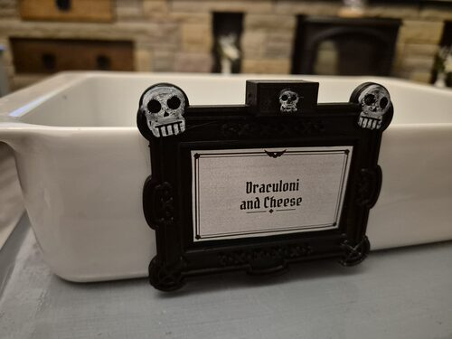

I designed and 3D printed a set of gothic Halloween buffet tags that hang on the side of a bowl, so the spooky name stays with the food. Each tag is a decorated frame that takes a standard sticky address label, held on by an adjustable ratchet clip that fits any rim from 2 to 10 mm thick.

[Gothic Halloween Buffet Tags with an Adjustable Bowl Clip](../docs/freecad/gothic-halloween-buffet-tags-with-adjustable-bowl-clip/)

<!-- truncate -->

The idea came from *The Big Bang Theory*, where Raj's "Food That Goes Bump in the Night" party menu is ordinary food with terrible pun names: Hallo-weenies, Night of the Living Garlic Bread, Draculoni and Cheese. A pun only works if your guests can read it, so I made a proper frame for it.

The tag prints in two parts in black PLA with no supports. The clip works like a zip tie: push it in until the tag grips the bowl and it clicks into place. There are four themes (bats and pumpkins, ghosts, spider webs and skulls) plus a blank frame, and they all use the same clip.

The article has photos, cross-sections showing how the clip works, the STL files and the Blender scripts used to make the themes.

[Read the full article and download the files](../docs/freecad/gothic-halloween-buffet-tags-with-adjustable-bowl-clip/)
