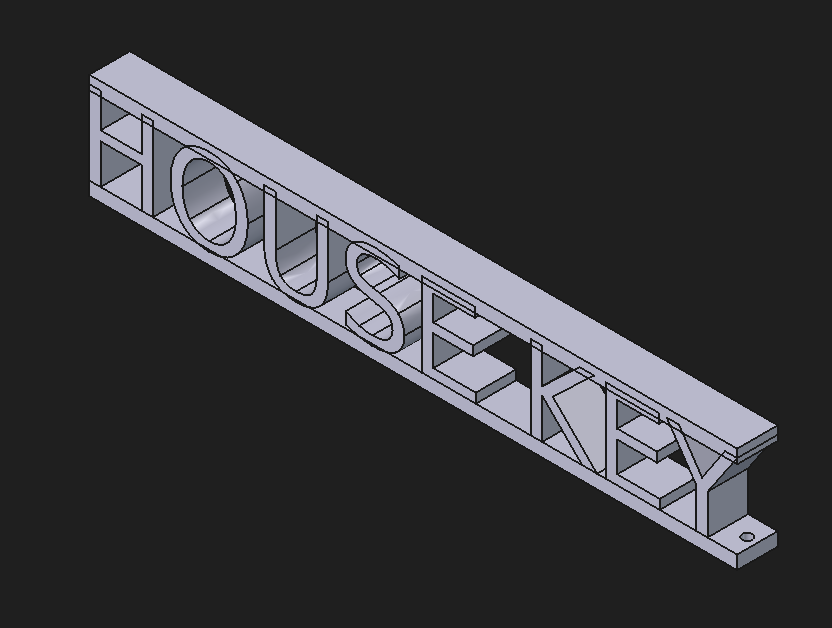
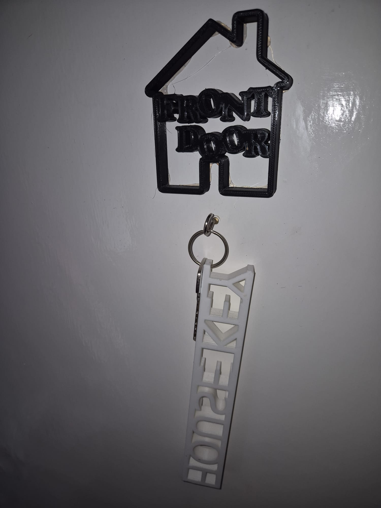
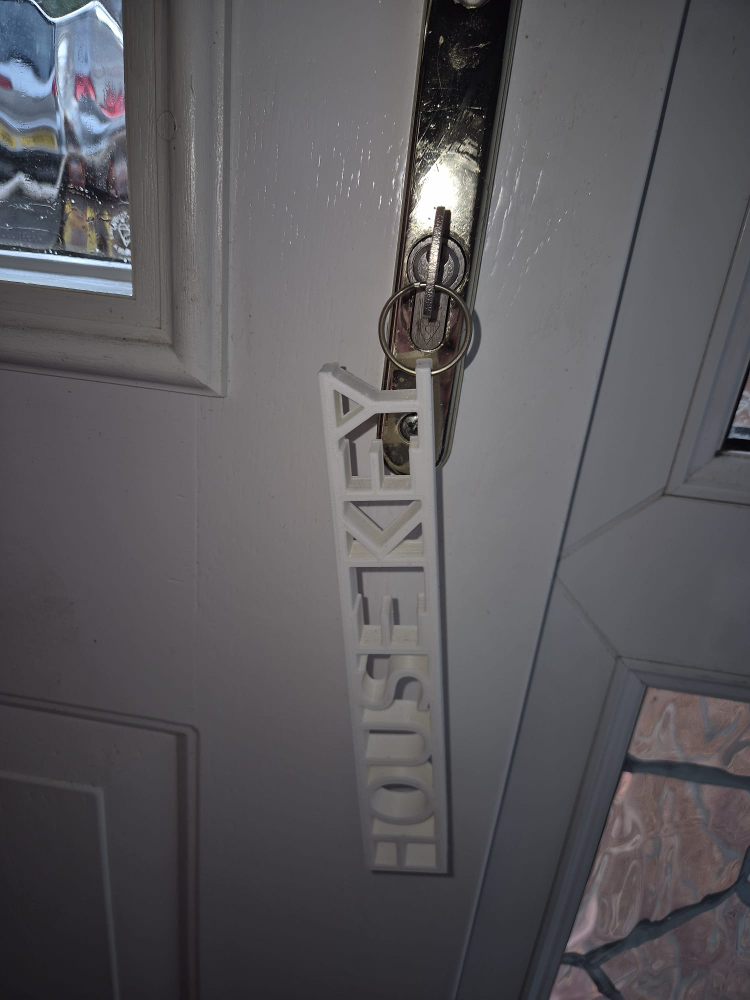
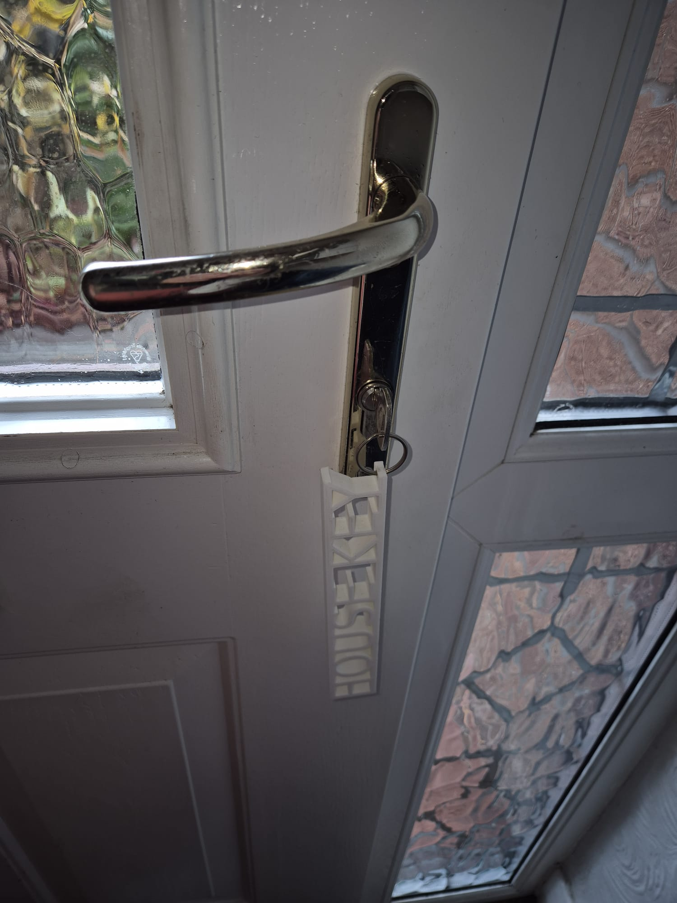

# Oversized "HOUSE KEY" Key Ring

A big, slim key ring that spells out **HOUSE KEY**, so the spare door key is always where it should be and always easy to find.

## Why this key ring?

### Easy to find in an emergency

Hang the key by the door and leave it there. The bold lettering makes it obvious which key it is, so anyone in the house can grab it quickly in an emergency, even if they are in a hurry, half asleep or don't know the house well.

### Too big for a pocket

At about 19 cm long, the key ring will not fit in a pocket. Nobody can absent-mindedly pocket the house key and walk off with it, leaving everyone else locked in or locked out. The key stays by the door where it belongs.

### Slides through the letter box

The key ring is slim, and the letters are held between two rails, one along the top and one along the bottom. The flat rails let it slide smoothly through a letter box. Lock the door from outside, then post the key back through the door so it is ready for the next person.

## Photos

Hanging on its hook by the front door, ready to grab:

In the front door lock:

## Details

| Feature | Value |
|---|---|
| Size | about 192 × 31 × 12 mm |
| Text | HOUSE KEY, in standing letters between two rails |
| Attachment | Small tab with a hole at one end for a split ring |

## Printing

- Print it lying flat on one side, so the letters and rails sit on the bed.
- No supports should be needed.
- PLA or PETG works well. Choose a bright colour so the key is easy to spot.

## Files

- `Housekey.stl` – ready-to-print model
- `Housekey.FCStd` – FreeCAD source file, if you want to change the text or size
